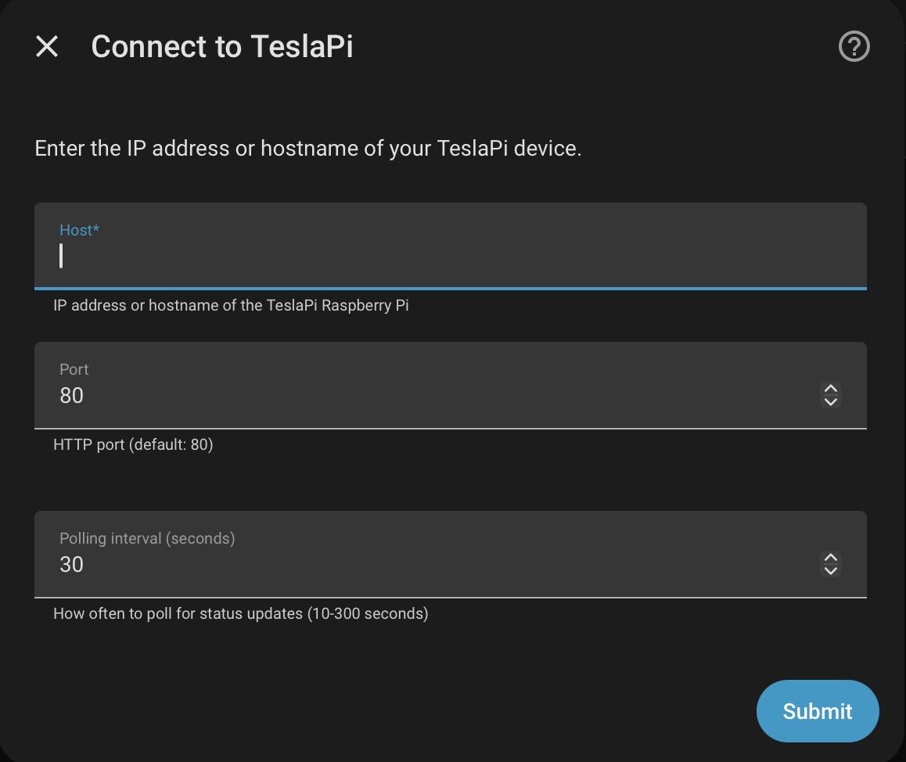
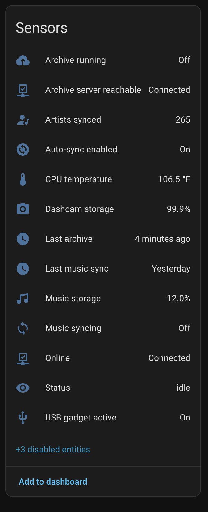
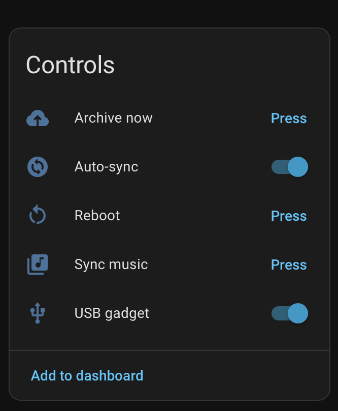

# TeslaPi Home Assistant integration

[](https://github.com/hacs/integration)

A Home Assistant custom integration for [TeslaPi](https://github.com/nickpdawson/TeslaPi), the Raspberry Pi USB drive for Tesla cars.

It shows the Pi's state, starts and cancels dashcam archives and music syncs, turns the USB gadget on and off, and lets you browse and play archived dashcam clips from the Media panel.

| Setup | Sensors | Controls |
|-------|---------|----------|
|  |  |  |

## Requirements

- Home Assistant 2025.8.0 or newer. Tested on 2026.10.
- A TeslaPi on your network with its API running.

## Installation

### HACS

1. Open HACS.
2. Open the menu in the top right and choose **Custom repositories**.
3. Add `https://github.com/nickpdawson/TeslaPi_HACS` with type **Integration**.
4. Search for **TeslaPi**, install it, and restart Home Assistant.

### Manual

1. Copy `custom_components/teslapi` from this repository to `config/custom_components/` on your Home Assistant host.
2. Restart Home Assistant.

## Setup

1. Go to **Settings > Devices & services > Add integration** and pick **TeslaPi**.
2. Enter the Pi's IP address or hostname. You can paste a URL such as `http://teslapi.local/`; the scheme and path are dropped, and `host:port` sets the port.
3. Enter the password if you set one on the Pi (see below). Leave it empty otherwise.
4. Change the port (default 80) or polling interval (default 30 seconds) if you need to.

Setup checks `/api/health` first, so "Cannot reach the TeslaPi" means the address or port is wrong or the Pi is off, and "rejected the password" means the address is right.

To change the address later, open the integration and choose **Reconfigure**.

### Password on the Pi

The TeslaPi web UI can set a password. Once one is set, the Pi refuses every API call that does not carry a session cookie. The integration logs in with `POST /api/auth/login`, keeps the cookie in its own HTTP session, and logs in again once if the cookie expires (the Pi issues 7-day sessions).

- Set the password on the Pi first, then enter the same password in Home Assistant.
- If you change it on the Pi, Home Assistant shows a **Reconfigure** prompt for the TeslaPi. Enter the new password there.
- To change the stored password yourself, open the integration options. Leave the field empty to keep the current one.

The password is stored in the config entry and is never written to the log or to diagnostics.

### Fallback hosts

A Pi can be reachable at more than one address, for example its home Wi-Fi IP and its hotspot IP. Add the others under **Configure > Fallback hosts**, one per line. They use the same port as the primary host.

When the active address stops answering, status reads try the others in order and switch to the first that answers. The diagnostic sensor **Active host** shows which address is in use. Actions that change something (start archive, toggle the gadget, reboot) go to the active address only. A timed-out write may still have started a job, and sending it to a second address could start it twice.

### Discovery

DHCP discovery finds Pis whose hostname starts with `teslapi`. When a known Pi gets a new IP, discovery moves the existing entry to it.

Zeroconf discovery looks for `_teslapi._tcp`. The TeslaPi server does not advertise that service yet. To turn it on, add this file on the Pi as `/etc/avahi/services/teslapi.service` and run `sudo systemctl restart avahi-daemon`:

```xml
<?xml version="1.0" standalone='no'?>
<!DOCTYPE service-group SYSTEM "avahi-service.dtd">
<service-group>
  <name replace-wildcards="yes">TeslaPi on %h</name>
  <service>
    <type>_teslapi._tcp</type>
    <port>80</port>
  </service>
</service-group>
```

## Entities

Entity IDs below assume the device is named `teslapi`.

### Sensors

| Entity | Description |
|--------|-------------|
| Status | Connected to car, Archiving, Syncing music, Idle, Error or Offline |
| Dashcam storage | Dashcam drive use, % |
| Music storage | Music drive use, % |
| Last archive | When the last archive finished |
| Last music sync | When the last music sync finished |
| Artists synced | Artists on the music drive |
| CPU temperature | Diagnostic |
| WiFi signal | Diagnostic, dBm, disabled by default |
| Last boot | Diagnostic, when the Pi last booted, disabled by default |
| RAM usage | Diagnostic, MiB, disabled by default |
| Active host | Diagnostic, the address in use |

### Binary sensors

| Entity | Description |
|--------|-------------|
| Online | On while the Pi answers. Stays available when the Pi is down, so it reads off rather than unavailable. |
| Archive running | A dashcam archive is in progress |
| Music syncing | A music sync is in progress |
| Archive server reachable | The NAS the Pi archives to answers |

### Buttons

| Entity | Description |
|--------|-------------|
| Archive now | Start a dashcam archive |
| Sync music | Start a full music sync |
| Reboot | Reboot the Pi (config entity) |

### Switches

| Entity | Description |
|--------|-------------|
| USB gadget | Present the drives to the car, or not |
| Auto-sync | The Pi's background auto-sync |

## Actions

All four actions take an optional target:

| Field | Description |
|-------|-------------|
| `device_id` | The TeslaPi device to act on |
| `config_entry_id` | The TeslaPi config entry to act on |

With one TeslaPi you can leave the target out. With two or more, every call needs `device_id` or `config_entry_id`; without one the action fails with "More than one TeslaPi is set up" rather than guessing which car to act on.

### `teslapi.start_archive`

| Field | Default | Description |
|-------|---------|-------------|
| `trigger` | `ha` | `ha` or `manual`, recorded by the Pi |
| `delete_after` | `false` | Delete clips from the dashcam drive after archiving |

### `teslapi.cancel_archive`

Cancels the running archive.

### `teslapi.start_music_sync`

| Field | Default | Description |
|-------|---------|-------------|
| `mode` | `full` | `full`, `selected`, `random` or `recent` |
| `paths` | | Artist or album folders for `selected` mode |
| `count` | `20` | How many items in `random` or `recent` mode |
| `type` | `artist` | `artist` or `album`, for `random` mode |

### `teslapi.cancel_music_sync`

Cancels the running music sync.

## Media browser

Archived dashcam clips are under **Media > TeslaPi Dashcam**, grouped by clip type, then by event time, then by camera.

Players never fetch clips from the Pi directly. Home Assistant resolves each clip to `/api/teslapi/clip/...`, a proxy that needs a Home Assistant login, streams the clip from the Pi with the session cookie, and passes `Range` through so seeking works. The Pi's address and cookie stay inside Home Assistant. Clip types, folder names and file names are checked against a fixed pattern before the request reaches the Pi.

The browser follows the Pi's paging and lists up to 2000 clips per clip type.

## Blueprint: sync music while charging

[](https://my.home-assistant.io/redirect/blueprint_import/?blueprint_url=https%3A%2F%2Fgithub.com%2Fnickpdawson%2FTeslaPi_HACS%2Fblob%2Fmain%2Fblueprints%2Fautomation%2Fteslapi%2Fsync_on_charge_cable.yaml)

[`blueprints/automation/teslapi/sync_on_charge_cable.yaml`](blueprints/automation/teslapi/sync_on_charge_cable.yaml) starts a music sync when the charge cable is plugged in at home, and cancels it when you look like you are leaving: the cable comes out while the driver door is open, or the door opens within a set time after unplugging. You pick the TeslaPi device, the car's charge cable and driver door sensors, a home sensor or tracker for the car, and optionally people who must be home and a notify action. Notifications carry Stop and Start buttons.

## Example automations

### Archive dashcam when the car gets home

```yaml
automation:
  - alias: "Archive dashcam on arrival"
    triggers:
      - trigger: state
        entity_id: device_tracker.tesla
        to: "home"
        for: "00:05:00"
    conditions:
      - condition: state
        entity_id: binary_sensor.teslapi_archive_server_reachable
        state: "on"
    actions:
      - action: teslapi.start_archive
        data:
          device_id: YOUR_TESLAPI_DEVICE_ID
          trigger: ha
```

### Warn when the dashcam drive is nearly full

```yaml
automation:
  - alias: "TeslaPi dashcam storage warning"
    triggers:
      - trigger: numeric_state
        entity_id: sensor.teslapi_dashcam_storage
        above: 90
    actions:
      - action: notify.mobile_app_your_phone
        data:
          title: "TeslaPi storage"
          message: "Dashcam drive is {{ states('sensor.teslapi_dashcam_storage') }}% full."
```

To find a device ID, open the device page; the ID is the last part of the URL. In the automation editor, pick the device from the action's target field instead.

## Troubleshooting

- **Cannot reach the TeslaPi.** Open `http://<pi>/api/health` in a browser from the same network as Home Assistant. If that fails, the problem is the network or the Pi, not the integration.
- **Rejected the password.** Log in to the TeslaPi web UI with the same password. If that works, re-enter it in **Configure**.
- **Entities go unavailable now and then.** The Pi drops off Wi-Fi when the car leaves. Add the other addresses it uses as fallback hosts, and check the **Active host** sensor.
- **Clips do not play.** The Pi streams archived clips from the NAS. If the NAS share is not mounted on the Pi, the proxy returns 502 and the Pi's own UI fails the same way.
- **More than one TeslaPi is set up.** Add `device_id` or `config_entry_id` to the action.

### Debug logging

Open the integration page and choose **Enable debug logging**, reproduce the problem, then **Disable debug logging** to download the log. Or add this to `configuration.yaml`:

```yaml
logger:
  logs:
    custom_components.teslapi: debug
```

**Download diagnostics** on the device page gives a snapshot with the password, addresses, SSID and hostnames removed. Attach it to issues.

## Breaking changes in 0.3.0

- Needs Home Assistant 2025.8.0 or newer.
- Entity unique IDs and the device identifier now use the config entry ID instead of the host. Existing entries are migrated on first start: entity IDs, names, areas and history stay. Do not downgrade to 0.2.x afterwards; restore a backup instead.
- Removed the **USB gadget active** and **Auto-sync enabled** binary sensors. They repeated the **USB gadget** and **Auto-sync** switches; use `switch.teslapi_usb_gadget` and `switch.teslapi_auto_sync`. The migration deletes the old registry entries.
- **Uptime** is now **Last boot**, a timestamp of the last boot instead of a seconds counter. Its entity ID does not change.
- **RAM usage** is in MiB (the old MB label was wrong). Its `total_mb` attribute is now `total_mib`. Home Assistant may raise a statistics repair for the unit change; accept it.
- **Status** no longer has a `timestamp` attribute.
- With more than one TeslaPi, actions need `device_id` or `config_entry_id`.
- Dashcam clips play through Home Assistant at `/api/teslapi/clip/...`, not from the Pi's address.
- Fallback hosts are stored as a list. The old comma-separated value is converted.

## License

MIT

## Links

- [TeslaPi](https://github.com/nickpdawson/TeslaPi), the server this integration talks to
- [TeslaPi API reference](https://github.com/nickpdawson/TeslaPi/blob/main/teslapi_api.md)
